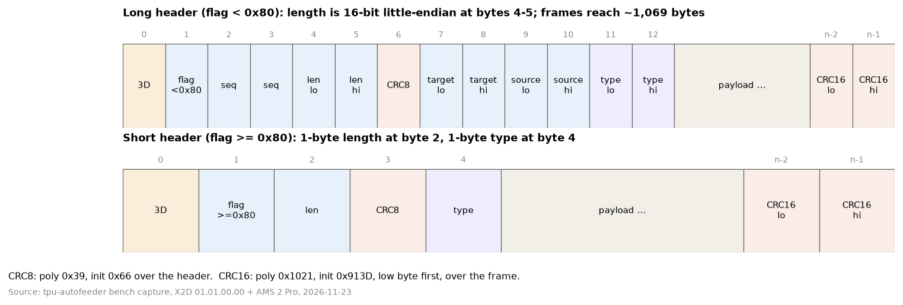
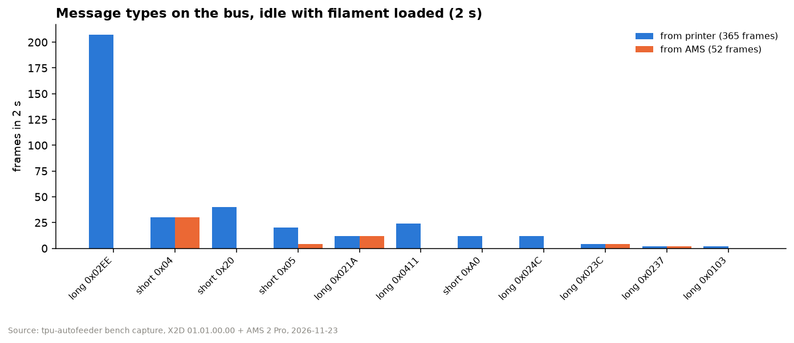
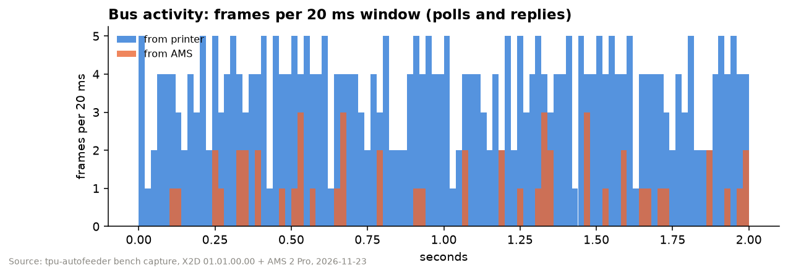
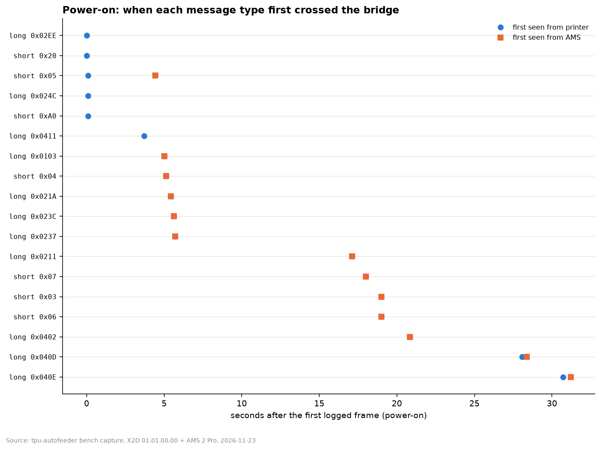
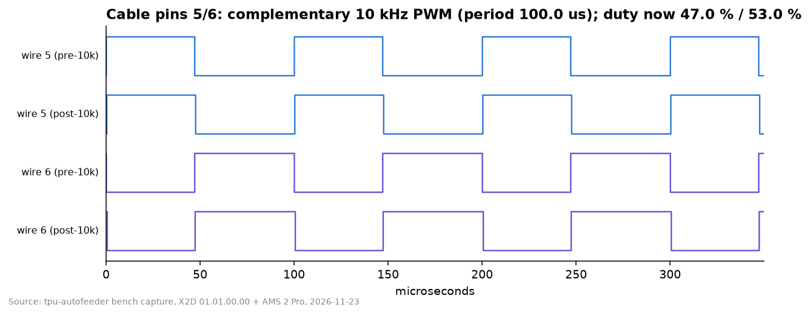
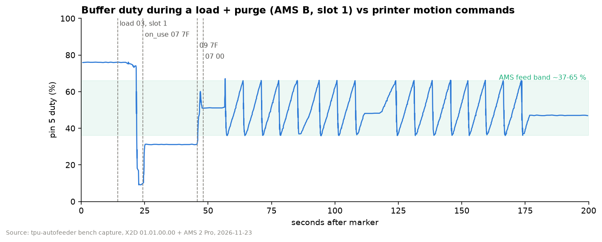
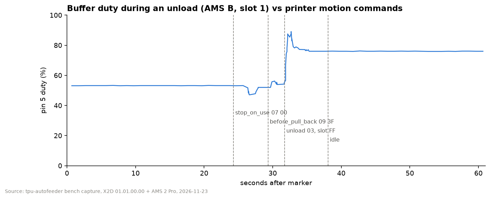
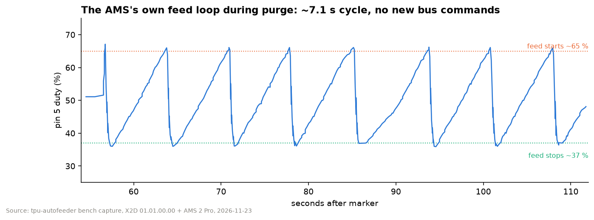
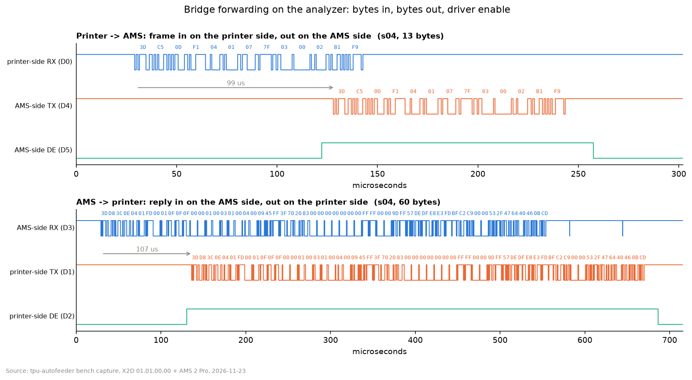
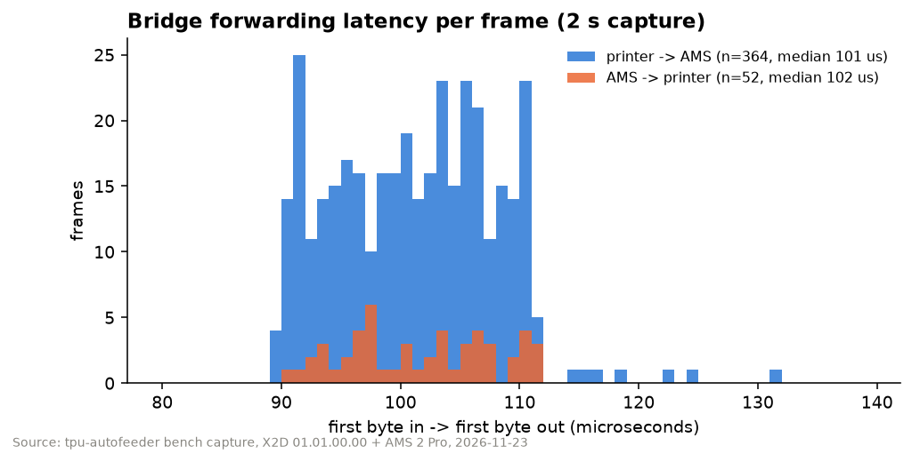

# Bambu Lab printer <-> AMS bus: consolidated reference

One place for what is known about the RS-485 bus between a Bambu Lab printer and its AMS units, with the
X2D + AMS 2 Pro as the measured case and notes on what applies to other models. Written for people building
their own AMS-compatible hardware or bus tools.

Compiled from the author's dated capture log, bench notes and source log (kept private because they hold
device identifiers), plus the frame parser in [`firmware/bus_parse/bus_parse.ino`](firmware/bus_parse/bus_parse.ino).

### Repository contents

| Path | What it is |
|---|---|
| `README.md` | This reference |
| `LICENSE`, `LICENSE-docs`, `NOTICE` | GPL-3.0 for code, CC BY 4.0 for docs and figures, third-party credit |
| `img/` | Figures rendered from real logic-analyzer and log captures |
| `charts/buffer_load_unload_2026-11-23.html` | Interactive buffer-duty chart (download and open in a browser) |
| `firmware/bus_parse/bus_parse.ino` | ESP32-S3 (XIAO) transparent RS-485 bridge + live frame parser used for every capture here |
| `tools/benchlog2.py` | Merges two bridge boards' USB logs into one timestamped log, with a shared marker channel |
| `tools/rawcap_unoq.sh` | sigrok capture loop for an FX2 logic analyzer on a small Linux host (8 MS/s, `.sr` chunks) |
| `tools/mkfigs.py` | Renders the figures from decoded captures |
| `tools/build_page.py` | Builds a standalone HTML page from this README (needs pandoc) |

Raw captures are not included: they contain the AMS's ASCII device ID and certificate bytes.

**License.** Code (`firmware/`, `tools/`) is GPL-3.0 ([LICENSE](LICENSE)). This README, the figures and the
chart (`README.md`, `img/`, `charts/`) are CC BY 4.0 ([LICENSE-docs](LICENSE-docs)): reuse them freely, crediting
"bambu-bus-reference by heavydms" with a link here. The frame parser in `bus_parse.ino` is ported from
[Bambu-Research-Group/Bambu-Bus](https://github.com/Bambu-Research-Group/Bambu-Bus) AMCU-v2 (GPL-3.0) and
modified; see [NOTICE](NOTICE).

## 1. Disclaimer

- **Unofficial.** This document is reverse-engineered from captures on the author's own printer and AMS
  units, plus published community work. It is **not affiliated with, authorized by or endorsed by Bambu Lab.**
  "Bambu Lab", "AMS", "X2D" and related names belong to their owners and are used here only to identify the
  hardware.
- **It may be wrong, and it may change.** Every decode below is a best reading of a limited set of captures.
  Bambu can change any of it with a firmware update. Items marked **?** are open.
- **Use at your own risk.** Wiring into the bus can damage the printer, the AMS or your own hardware (pin 1
  carries 24 V on the printer side). Power everything off before plugging or unplugging a bus connector.
- **Do not use this to defeat Bambu's authentication.** The bus carries a certificate and signed-challenge
  exchange (0x040D/0x040E). This document describes that it exists and when it runs. It contains no keys, no
  certificate data and no method to bypass it, and none should be added.
- Device serial numbers, the ASCII device ID carried in short 0x05 frames, tag UIDs and tray UIDs were seen
  on the bus and are deliberately **not** recorded.

**Firmware observed:**

| Device | Versions | When |
|---|---|---|
| X2D printer | Firmware before 2026-11-21 (version not recorded in the notes); downgraded to **01.01.00.00** on 2026-11-21; later upgraded back to its latest firmware (version not recorded) | Captures 2026-11-20 to 2026-11-23 |
| AMS 2 Pro (x2) | **05.00.22.19** (as found) -> **04.00.21.90** (reflashed by the printer during the downgrade) -> **05.00.22.19** (reflashed on the upgrade back). AMS loader "Version: 23" | Same |
| Other AMS 2 Pro versions, published only | 03.00.21.29, 04.00.21.87, 05.00.22.22 [Published: [OpenAMS][openams] `cortex_bridge/ams_firmware.json`] | Not run here |

### Provenance tags

Every claim carries a tag:

- **[Published: source]**: a published source states it (prior-art.md (the author's source log) records which).
- **[Measured: date]**: comes only from our own captures on the X2D + AMS 2 Pro.
- Both tags: we confirmed a published claim on our hardware.
- **New**: not found in any published source in a targeted search on 2026-11-23 (Bambu wiki, GitHub
  including every Bambu-Bus issue, Bambu forum, Reddit; see the "Novelty search" entry in
  prior-art.md (the author's source log)). That is absence of evidence, not proof; corrections welcome.
- Figures are rendered from real captures by [tools/figs/mkfigs.py](tools/mkfigs.py).

Link targets for the short source names are in [section 12](#12-sources).

---

## 2. Quick facts

| Item | Value | Provenance |
|---|---|---|
| Physical layer | RS-485, half-duplex, one differential pair (cable pins 3/4) | [Published: [Bambu-Bus][bb], [Dr Terrible][drt]] [Measured: 2026-11-20] |
| Baud / format | **1,228,800 baud, 8E1** (even parity). Bit time 0.814 us | [Published: [Bambu-Bus][bb]] [Measured: 2026-11-20] |
| Alternative baud | 1,250,000 decoded cleanly on one FT232 rig where 1,228,800 gave CRC errors | [Published: [Bambu-Bus issue #12][bb]] |
| Frame start | `0x3D` | [Published: [Bambu-Bus][bb]] [Measured: 2026-11-20] |
| Headers | Short (byte 1 bit 7 set, 1-byte length) and long (bit 7 clear, 16-bit LE length) | [Published: [Bambu-Bus][bb]] [Measured: 2026-11-21] |
| Frame CRC | CRC16, poly 0x1021, init 0x913D, no reflection, no xorout, stored little-endian | [Published: [Bambu-Bus][bb]] [Measured: 2026-11-20] |
| Header CRC | CRC8, poly 0x39, init 0x66, over bytes 0-2 / 0-5, at byte 3 / 6 | [Published: [Bambu-Bus][bb]] [Measured: 2026-11-23, 417/417] |
| Largest frame seen | **1069 B** (AMS firmware data frames); long frames over 255 B are normal during updates | [Measured: 2026-11-21] |
| Poll cycle | ~5 ms; ~179-183 frames/s printer->AMS, ~17-26 frames/s AMS->printer at idle | [Measured: 2026-11-20/21/23] |
| Bridge latency | Cut-through forwarding, first byte in -> first byte out **median ~101 us** (both directions, 90-132 us) | [Measured: 2026-11-23] |
| AMS reply turnaround | 0.18-2.28 ms after the request ends (longest normal reply ~1.55 ms) | [Measured: 2026-11-20] |
| Reply deadline | **Not measured** | gap |
| AMS bus address | 0x0007 (one address for both daisy-chained AMS units) | [Published: [Bambu-Bus][bb]] [Measured: 2026-11-21] |
| Printer addresses | 0x0003 motion controller, 0x0006 AP, 0x0009 AP2 / updater, 0x000A authenticator | [Published: [Bambu-Bus][bb]] [Measured: 2026-11-21] |
| Buffer signal | Cable pins 5/6: **complementary 10 kHz PWM, duty = filament buffer position**, not RS-485 | [Measured: 2026-11-21, 2026-11-23] **New** |
| Auth | 0x040D (certificate) and 0x040E (signed random challenge); enforced on X2D >= 01.01.00.00 | [Published: [BMCU locks doc][locks], [BMCU #80][i80]] [Measured: 2026-11-20] |
| Power | AMS 2 Pro runs from its own 24 V adapter; the printer powers the AMS over pin 1 on X1/P1 | [Published: [Bambu wiki power][wikipwr]] [Measured: 2026-11-20] |

---

## 3. Physical layer

### 3.1 Six-pin port pinout

Looking into the port, notch up, pin 1 top-left, then across and down (top row 1 2 3, bottom row 4 5 6).
For a straight-through cable between two identical ports, the same face position is the same wire, so pin
numbers match end to end [Measured: 2026-11-20].

| Pin | Function | Provenance |
|---|---|---|
| 1 | **24 V** (printer side; unused/open on the externally powered AMS 2 Pro) | [Published: [Dr Terrible][drt], [Bambu wiki power][wikipwr]] [Measured: 2026-11-20] |
| 2 | **GND** (the longer pin on X1) | [Published: [Dr Terrible][drt]] [Measured: 2026-11-20] |
| 3 | RS-485 bus, the **inverting (-) line**. Bambu's wiki calls it "sig-A" | [Published: [Dr Terrible][drt] ("pair A -")] [Measured: 2026-11-20] |
| 4 | RS-485 bus, the **non-inverting (+) line**. Bambu's wiki calls it "sig-B" | [Published: [Dr Terrible][drt] ("pair A +")] [Measured: 2026-11-20] |
| 5 | **Buffer_B**: buffer position PWM (71 % duty at rest on 2026-11-21) | [Published: [Bambu wiki buffer page][wikibuf] (names)] [Measured: 2026-11-21] |
| 6 | **Buffer_A**: exact complement of pin 5 | [Published: [Bambu wiki buffer page][wikibuf] (names)] [Measured: 2026-11-21] |

- **Which of 5/6 is Buffer_A vs Buffer_B** comes from reading Bambu's mirrored diagram plus our tap on pin 5,
  so treat the label as **?** If you wire 5->5 and 6->6, it does not matter [Measured: 2026-11-21].
- **Bambu's wiki pin figure shows the cable plug face, so it is mirrored against the port face.** Mirrored to
  the port face it reads: top row 24V, GND, sig-A; bottom row sig-B, blank, blank. It leaves 5/6 blank
  [Published: [Bambu wiki power][wikipwr]]. The 4-pin printer-side connector (X1/P1) is drawn as top row GND,
  24V; bottom row sig-A, sig-B [Published: [Bambu wiki power][wikipwr]].
- **Correction:** an earlier note (from an early source read) gave "1 = B, 2 = A, 3 = GND, 4 = 24 V, 5/6 = NC".
  That is wrong for this hardware; the table above is metered [Measured: 2026-11-20].
- The fake-AMS-lite board for the A1 uses a 4-pin XH2.54 connector: GND, B, A, 24 V
  [Published: [AMCU-ALL-v2][amcuall]].

### 3.2 A/B polarity caveat

**The wiki's "sig-A"/"sig-B" names do not follow transceiver A/B.** Connect **cable pin 4 to the
transceiver's A terminal and pin 3 to B** [Measured: 2026-11-20, 2026-11-23].

- First passive sniff: wired by the names, there were no `0x3D` bytes and the first byte read `C2` (0x3D
  bit-inverted). With the RX inverted it decoded cleanly. Swapping the wires fixed it [Measured: 2026-11-20].
- The same flip appeared again on the two-board bench: cable wire 3 idled low (electrically RS-485 B), and the
  frames decoded only inverted until wires 3/4 were swapped at both modules [Measured: 2026-11-22, 2026-11-23].
- A firmware RX-invert is not a real fix: it also inverts the idle level between frames [Measured: 2026-11-23].

### 3.3 Levels, termination and bias

- Pair A uses 3.3 V signaling; the X1 AMS uses a 3PEAK TP75176E transceiver [Published: [Dr Terrible][drt]].
  Proven bus front ends in published boards: TP75176E-SR at 3.3 V with SM712 TVS on A/B and SMBJ24CA on
  24 V [Published: [AMCU-ALL-v2][amcuall]]; THVD1450DR with a 5 A fuse, 28 V TVS and reverse-polarity
  P-MOSFET [Published: [OpenAMS Cortex Bridge][cortex]].
- **Unpowered health check (X1/P1 values):** per node, GND-A 4-5 kOhm, GND-B 4-5 kOhm, A-B 8-10 kOhm; with
  two nodes in parallel about half that. Bambu's wiki states there is no 120 Ohm terminator on the bus
  [Published: [Bambu wiki HMS 0700-5000-0002-0001][wikihms]].
- **X2D measurements contradict "no terminator" on the printer side** (power off, kOhm, at the filament
  buffer's printer ports) [Measured: 2026-11-20]:

  | Pair | Printer side | AMS 2 Pro port |
  |---|---|---|
  | 3-4 | **0.08 (80 Ohm)**: looks like termination | 8.94: no terminator, like the wiki |
  | 2-3 / 2-4 | 1.33 / 1.34 (matched, likely bias to GND) | 4.43 / 5.11 |
  | 5-6 | 11.56 | 8.93 |
  | 1-x | climbs to ~16-18 (bulk capacitors on 24 V) | pin 1 open to everything |

  So the X2D side **may terminate and bias the bus**, and the bias appears to live on the printer side
  [Measured: 2026-11-20]. **?** Confirmed only by resistance, not by schematic.
- **Idle bus:** the bus is undriven between frames. A non-fail-safe receiver (MAX3485) reads the idle line as
  noise (short ~0.17 us spikes and "junk" bytes) [Measured: 2026-11-20]. When the bus is cut for a bridge, the
  AMS-side segment has no bias and floats between frames; a frame-gated forwarder drops that junk
  [Measured: 2026-11-20]. A fail-safe bias on the AMS side (A to 3.3 V, B to GND, ~680 Ohm-1 kOhm) was
  planned but not needed for a working bridge.
- An extra 120 Ohm terminator on a bench module caused **no CRC problems** on the live X2D bus (2 CRC failures
  in the first ~1000 frames, none growing after) [Measured: 2026-11-20].

### 3.4 Two pairs: bus vs buffer

- **Pins 3/4 are the only RS-485 pair on the cable.** Every bus device we saw, including the Filament Track
  Switch (0x0025) and exhaust fan (0x0028), talks on pins 3/4 [Measured: 2026-11-22, 2026-11-23].
- **Pins 5/6 are not a second bus.** They carry the buffer PWM (section 8). A bench that tried to bridge 5/6
  as RS-485 saw only 100.0 us pulses and blocked the buffer signal [Measured: 2026-11-22].
- On the X1, pair B carries the AMS Hub magnet-sensor state, chained back to the AMS; its duty cycle encodes
  magnet position and it does not connect back to the printer [Published: [Dr Terrible][drt]].
- **Any interposer must pass pins 5/6 straight through.** Without them the printer reports "AMS A/B Filament
  buffer position signal lost" (HMS 0700-4000-0002-0001 for AMS A, 0701-4000-0002-0001 for AMS B) and loads
  fail with the AMS text `buffer offline!` [Published: [Bambu wiki buffer page][wikibuf]]
  [Measured: 2026-11-20, 2026-11-21].

### 3.5 Power

- On X1/P1 the printer powers the AMS over the bus at 24 V [Published: [Bambu wiki power][wikipwr]].
- The AMS 2 Pro on the bench ran from its external **DC 24 V 4 A** adapter; pin 1 on its port is open
  [Measured: 2026-11-20]. H2/P2/X2D printers can power one AMS 2 Pro for drying without an adapter
  [Published: Bambu US store, AMS 2 Pro page, read 2026-11-17].
- The **TPU Feed Assist Module** draws power from the AMS port through its 4-to-6-pin adapter and **never
  transmits on the bus**. Its control is all buttons [Published: [Bambu wiki TPU Feed Assist][tpuwiki]]
  [Measured: 2026-11-21].
- The AMS text reports adapter state: `[AMS_ADA]init, shut off, vol:0.0V`, later `vol:0.6V`
  [Measured: 2026-11-20]. AMS 2 Pro HMS `07XX_9800_0002_0001/2` = PSU voltage low/high
  [Published: [BamDude][bamdude]].

---

## 4. Framing

*Long and short header byte maps; CRC positions verified on 417 live frames.*

Byte offsets count from the `0x3D` start byte. The total length field counts every byte of the frame,
including the trailing CRC16 [Published: [Bambu-Bus][bb]] [Measured: 2026-11-20].

### 4.1 Short header (byte 1 bit 7 set)

| Byte | Content | Provenance |
|---|---|---|
| 0 | `0x3D` | [Published: [Bambu-Bus][bb]] [Measured] |
| 1 | Flags; **bit 7 = 1** marks a short frame (seen: `C0`) | [Published: [Bambu-Bus][bb]] [Measured: 2026-11-20] |
| 2 | **Total length**, 1 byte | [Published: [Bambu-Bus][bb]] [Measured: 2026-11-20] |
| 3 | **CRC8** over bytes 0-2 | [Published: [Bambu-Bus][bb]] [Measured: 2026-11-23, 136/136 short frames] |
| 4 | **Type** (0x03, 0x04, 0x05, 0x06, 0x07, 0x08, 0x20, 0xA0) | [Published: [Bambu-Bus][bb]] [Measured: 2026-11-20] |
| 5 .. len-3 | Payload | |
| len-2, len-1 | CRC16, little-endian | [Measured: 2026-11-20] |

In this document short payloads are written starting at the type byte, e.g. `03 00 07 01 00 02`.

### 4.2 Long header (byte 1 bit 7 clear)

| Byte | Content | Provenance |
|---|---|---|
| 0 | `0x3D` | [Published: [Bambu-Bus][bb]] |
| 1 | Flags; **bit 7 = 0** marks a long frame (seen: `00`, `05`) | [Published: [Bambu-Bus][bb]] [Measured] |
| 2-3 | Not decoded in our notes (seen `C2 0F` on a firmware frame, `00 00` on 0x02EE) **?** | [Measured: 2026-11-21] |
| 4-5 | **Total length, 16-bit little-endian** (`C9 01` = 457) | [Measured: 2026-11-21] |
| 6 | **CRC8** over bytes 0-5 | [Published: [Bambu-Bus][bb]] [Measured: 2026-11-23, 281/281 long frames] |
| 7-8 | **Target address** | [Published: [Bambu-Bus][bb]] [Measured: 2026-11-21] |
| 9-10 | **Source address** | [Measured: 2026-11-21] |
| 11-12 | **Type**, little-endian (`EE 02` = 0x02EE) | [Published: [Bambu-Bus][bb]] [Measured: 2026-11-20] |
| 13 .. len-3 | Payload (byte 13 is the sub-command in 0x0106, a toggling byte in 0x0411) | [Measured: 2026-11-21] |
| len-2, len-1 | CRC16, little-endian | [Measured: 2026-11-20] |

Example (printer to the 0x02EE broadcast target, as decoded from a single-ended probe):
`3D 05 00 00 10 00 13 00 0F 00 03 EE 02 00 23 0E` (length 0x0010 = 16 B) [Measured: 2026-11-22].

**Address byte order caveat.** Bytes 7-10 hold the address high byte first (`00 0F`, `00 03`). Our firmware
reads them little-endian, so the same address prints as 0x0F00 / 0x0300 in raw logs, and early notes wrote
"target 0x0700" (AMS), "0x0A00" and "0x2500". This document uses the `0x00NN` form (0x0007, 0x000A, 0x0025)
throughout [Measured: 2026-11-20/22]. The BMCU firmware uses 0x0700 + 0x0801*n for AMS units, in the other
form [Published: [BMCU-C-PJARCZAK][bmcu]].

### 4.3 Lengths

- Normal traffic is all under 256 B [Measured: 2026-11-21].
- **Long frames over 255 B do occur:** 457 B (firmware header) and 1065 B / 1069 B (firmware data)
  [Measured: 2026-11-21]. A parser that reads only byte 4 truncates them (see section 10.3).
- Rule for any device on this bus: **handle long frames of at least 1069 B with a 16-bit length**. Our
  parser allows 1536 B [Measured: 2026-11-21].

### 4.4 CRCs

- **CRC16:** poly 0x1021, init 0x913D, no reflection, no final XOR, computed over every byte from `0x3D` up
  to (not including) the two CRC bytes, stored low byte first. Verified on a live 31-byte short 0x05 frame
  (CRC 0x21DB) [Published: [Bambu-Bus][bb]] [Measured: 2026-11-20].
- **CRC8:** poly 0x39, init 0x66, MSB-first, no reflection, no final XOR, over header bytes 0-2 (short) or
  0-5 (long), stored at byte 3 (short) or 6 (long) [Published: [Bambu-Bus][bb]].
- **Both verified on 417 live frames** (2 s capture, 365 from the printer, 52 from the AMS; 136 short, 281 long):
  CRC8 417/417, CRC16 417/417, length field = actual length 417/417 [Measured: 2026-11-23]. Our bridge forwards
  without checking either; its parser validates only the CRC16 [Measured: 2026-11-21].

---

## 5. Addresses

| Address | Role | Evidence | Provenance |
|---|---|---|---|
| 0x0003 | Printer **motion controller (MC)**; polls the AMS and sends short motion commands | Source of most P->A traffic | [Published: [Bambu-Bus][bb] ("0x03 MC")] [Measured: 2026-11-21] |
| 0x0006 | Printer **AP** (main computer). Sends 0x0218 (set tray), 0x0211 requests, 0x0245 | B3 material set | [Published: [Bambu-Bus][bb] ("0x06 AP")] [Measured: 2026-11-21] |
| 0x0007 | **AMS.** Both daisy-chained AMS 2 Pro units answer from 0x0007; the unit id (`ams-0x00` / `ams-0x01`) is inside the payload | Every A->P frame | [Published: [Bambu-Bus][bb] ("0x07 AMS")] [Measured: 2026-11-21] |
| 0x0009 | Printer **AP2**; source of the AMS firmware update (0x0106) | Downgrade/upgrade | [Published: [Bambu-Bus][bb] ("0x09 AP2")] [Measured: 2026-11-21] |
| 0x000A | **Printer-side authenticator**: target of the AMS's 0x040E answers and the auth peer of 0x0025/0x0028 | Auth frames | [Measured: 2026-11-20, 2026-11-23] **New** |
| 0x000E | Queried with 0x0103/0x0402 (version); **never answers** | Boot and TPU Feed Assist test | [Measured: 2026-11-21] |
| 0x000F (0x0F00 raw) | Target of the 0x02EE broadcast, no reply | Idle | [Measured: 2026-11-20] |
| 0x0F01 | Queried with 0x0103 (version), never answers **?** (address form as logged) | TPU Feed Assist test | [Measured: 2026-11-21] |
| 0x0025 | **Filament Track Switch (FS01).** Target of 0x024C and half of 0x0411; authenticates with 0x000A. Every 0x0025 frame disappeared when the switch was removed | Removal test | [Measured: 2026-11-21] **New** |
| 0x0028 | **Exhaust fan, probably.** Polled right before a fan "certification failed" error; later seen authenticating (`040D src 0x0028`); still polled with 0x0411 after the switch was removed | Fan error, auth frames | [Measured: 2026-11-21] **New** |
| 0x0012 | AMS lite | Not on our bus | [Published: early read of the fake-AMS projects ([druckgott][druckgott] / [Bambu-Bus][bb])] |

Short 0xA0 polls also carry a one-byte id: 0x00, 0x27, 0x28 (section 6.1) [Measured: 2026-11-21].

**Multiple AMS units at one address:**

- On the X2D, AMS #2 (daisy-chained off AMS #1's second port) is never seen at its own address. Its replies
  and debug text come back through AMS #1 at 0x0007 [Measured: 2026-11-21].
- The AMCU-v2 emulator also presents **four AMS units from one bus address** (`filament[4][4]`, unit number
  `AMS_num` in `buf[5]` of each request; one online-detect reply carries four unit records)
  [Published: [Bambu-Bus AMCU-v2][bbcpp]].
- Discovery (OpenAMS, as master): an unindexed AMS announces itself about twice a second (marker 0xFF for
  AMS 1 / AMS 2 Pro, 0xFE for AMS HT); the master offers an index (0-3; HT 0x80-0x87); an AMS 2 Pro keeps
  its index through power cycles [Published: [OpenAMS][openams]]. Not seen on our captures (we never caught a
  fresh discovery) **?**
- The unsourced "AMS deep dive" claim that AMS units sit at 0x0700-0x0703, assigned dynamically, is
  **not supported** by our captures (only 0x0007 seen) **New** (see section 11.2).

**Bus legs:** the exhaust fan and the track switch sat on the printer's side of our bench cut. We saw the
printer's frames to them (and their auth) but not always their replies [Measured: 2026-11-21, 2026-11-23].

---

## 6. Message types

Direction "P->A" means printer to AMS (or to another device on the printer's side); "A->P" the reverse.
Lengths are whole frames. Confidence: **H** = decoded and cross-checked, **M** = decoded from one capture
set or one source, **L** = seen, meaning unknown.

*2 s idle with filament loaded: 365 frames from the printer (207 of them 0x02EE), 52 from the AMS [Measured: 2026-11-23].*

*Frames per 20 ms window over the same 2 s.*

### 6.1 Short types

| Type | Dir | Length | Meaning | Conf. | Provenance |
|---|---|---|---|---|---|
| 0x03 | P->A, echoed/answered A->P | 12 B -> 44 B | **Motion command** for one AMS: `03 [ams_id] [en | mode<<1] [idx] [ref] [?]` (section 6.3) | H | [Published: [Bambu-Bus][bb], [BMCU][bmcu]] [Measured: 2026-11-21] |
| 0x04 | P->A -> A->P | 13 B -> 60 B | **Motion/status poll**: `04 00 [en | mode<<1] [ref] 03 [idx]`. Idle `04 00 01 00 03 FF`, hold `04 00 07 7F 03 01`. The 60 B reply is AMS status; a few count/flag bytes change **?** | H (request), L (reply) | [Published: [Bambu-Bus][bb]] [Measured: 2026-11-21] |
| 0x04 reply offsets 22-33 | A->P | | Motor samples: hub motor 22-27, per-slot first stage 28/30/32 on an AMS 2 Pro | M | [Published: [OpenAMS][openams]] (not checked by us) |
| 0x05 | P->A, answered | 31 B | Online/identity exchange ("online" in the Bambu-Bus map). Alternates between all zeros and a frame carrying **an ASCII device ID** (not recorded) | M | [Published: [Bambu-Bus][bb]] [Measured: 2026-11-20/21] |
| 0x06 | P->A -> A->P | 12 B -> 60 B | Request type 6; rose from 1 to 78 pairs/min during spool initialization **?** | L | [Measured: 2026-11-20] |
| 0x07 | P->A, echoed | 13 B | `07 [ams_id] 00 [flag]`; flag `00` when a spool starts being pulled, `01` after a spool is inserted. Bambu-Bus: "read NFC info". **No tag data crosses the bus** | M | [Published: [Bambu-Bus][bb]] [Measured: 2026-11-21] |
| 0x08 | P->A | >= 45 B | Older set-filament-info form: byte 5 = `ams<<4 | tray`, id at +7, RGBA at +15, temps at +19/+21, name at +23. **Not seen on the X2D** | M | [Published: [BMCU][bmcu]] |
| 0x20 | P->A | 41 B | Payload all zeros in samples; the Bambu-Bus map calls it heartbeat. **Reply conflict:** the 2026-11-20 sniff paired it with a 33 B reply (0.31-0.70 ms); the 2026-11-21 full-log check found **0 A->P 0x20 frames**. Prefer the later check; the 33 B reply may have been another type **?** | L | [Measured: 2026-11-20, 2026-11-21] |
| 0xA0 | P->A | | Printer poll every 500 ms: `A0 00 02 00 <id> 00`, id 0x00 / 0x27 / 0x28. Rare reply `3D C0 13 ... A0 03 ...` from the printer-side leg **?** | L | [Measured: 2026-11-21] |

### 6.2 Long types

| Type | Dir / addresses | Length | Meaning | Conf. | Provenance |
|---|---|---|---|---|---|
| 0x02EE | 0x0003 -> 0x000F | 16 B | Most frequent frame, about every 5 ms, **never answered**. X2D-specific broadcast; payload not decoded | L | [Measured: 2026-11-20] **New** |
| 0x021A | 0x0003 -> 0x0007 -> | 19 B -> 21-217 B | Poll whose AMS reply carries **ASCII debug log lines** (NUL-separated, from payload byte 14 to the CRC); 2 frames per heartbeat line (section 6.6) | H | [Published: [Bambu-Bus AMCU-v2][bbcpp] (type handled)] [Measured: 2026-11-20] |
| 0x0209 | A->P | | `[MCU_UP]` text from the AMS loader during a firmware update | M | [Measured: 2026-11-21] |
| 0x023C | P->A -> A->P | 19 B -> 72 B | Regular poll (942 changes/h at idle); not decoded | L | [Measured: 2026-11-20] |
| 0x0237 | P->A -> A->P | 18 B -> 40 B | Regular poll (48 changes/h at idle); not decoded | L | [Measured: 2026-11-20] |
| 0x024C | 0x0003 -> 0x0025 | 16 B -> 50 B | Poll of the Filament Track Switch; not decoded | L | [Measured: 2026-11-21] **New** |
| 0x0411 | 0x0003 -> 0x0025 and 0x0028 | 19 B | Poll to the track switch and exhaust fan; byte 13 toggles `FF` <-> `01`, byte 8 changes too **?** | L | [Measured: 2026-11-21] **New** |
| 0x0245 | 0x0006 -> AMS | | Appeared during the first load command; 1 change in an idle hour; not decoded | L | [Measured: 2026-11-20] **New** |
| 0x0103 | P->A | | Version query (boot; also sent unanswered to 0x000E and 0x0F01) | M | [Published: [Bambu-Bus AMCU-v2][bbcpp]] [Measured: 2026-11-20] |
| 0x0402 | P->A | | Version (boot; also to 0x000E, unanswered) | M | [Published: [Bambu-Bus AMCU-v2][bbcpp]] [Measured: 2026-11-20] |
| 0x0211 | 0x0006 -> 0x0007 -> | 18 B request -> **151 B** tray record | **Read tray filament record** (section 6.5). Request `01 02` = AMS 1, tray 2 | H | [Published: [Bambu-Bus AMCU-v2][bbcpp], [BMCU][bmcu]] [Measured: 2026-11-21] |
| 0x0218 | 0x0006 -> 0x0007 | | **Set tray filament** (section 6.4); AMS acks with a short (5-byte) answer | H | [Published: [BMCU][bmcu]] [Measured: 2026-11-21] |
| 0x040D | both | 21 B -> 187 B | **Certificate** exchange (auth) | H (role) | [Published: [BMCU locks doc][locks]] [Measured: 2026-11-20/21] |
| 0x040E | both | 52 B -> 91 B | **Signed random challenge** (auth); bytes change every time | H (role) | [Published: [BMCU locks doc][locks]] [Measured: 2026-11-20/21] |
| 0x0106 | 0x0009 -> 0x0007, replies 0x0106 | 41 B to 1069 B | **AMS firmware update transport** (section 7.9) | H (transport) | [Measured: 2026-11-21] **New** |

The 0x0211 reply length direction was logged once as "151 -> 18 B" in the 2026-11-20 turnaround table; the
2026-11-21 decode (18 B request, 151 B reply) is the later and checked reading [Measured: 2026-11-21].

### 6.3 Motion command encoding (short 0x03 / 0x04)

The AMS debug text echoes each command as `[AMS_LINK]en:E,mode:M,idx:I,ref:R`. On the wire
[Measured: 2026-11-21]:

- Byte `[en | mode<<1]`: mode 0/1/2/3/4 with en = 1 is sent as **0x01/0x03/0x05/0x07/0x09**.
- `idx` = tray 0-3 within the **selected** AMS; 0xFF (255) = none.
- `ref` is sent raw: 0x00, 0x3F (63), 0x7F (127), 0x80 (128). It is part of a state code, not a number.
- The last byte of 0x03 (00/02) is unknown **?** It flips 00 -> 02 about 0.6 s into an unload or load.
- Examples: `03 00 07 01 00 02` = AMS 0, mode 3, idx 1, ref 0. `03 00 09 01 3F` = mode 4, idx 1, ref 63.
  `03 00 03 FF 00` = mode 1, idx 255 (unload). `03 01 05 00 80` = AMS 1, mode 2, idx 0, ref 128 (RFID read).

| Wire (flag, ref) | AMS text | BMCU state name | When we see it | Provenance |
|---|---|---|---|---|
| `01`, idx `FF` | mode:0, idx:255 | idle | idle | [Measured: 2026-11-20] |
| `03 00`, idx 0-3 | mode:1, ref 0 | send_out (feed to the toolhead) | every load | [Published: [Bambu-Bus AMCU-v2][bbcpp], [BMCU][bmcu]] [Measured: 2026-11-21] |
| `03 xx`, idx `FF` | mode:1, idx:255 | pull back (unload) | every unload | [Published: [BMCU][bmcu]] [Measured: 2026-11-21] |
| `05 80` | mode:2, ref:128 | (RFID read + odometer calibration of tray idx) | boot, re-read, spool insert | [Measured: 2026-11-20] |
| `07 7F` | mode:3, ref:127 | on_use (assist/hold while printing) | the long hold after a load | [Published: [Bambu-Bus AMCU-v2][bbcpp], [BMCU][bmcu]] [Measured: 2026-11-21] |
| `07 00` | mode:3, ref:0 | stop_on_use | before an unload | [Published: [BMCU][bmcu]] [Measured: 2026-11-21] |
| `09 7F` / `09 A5` | mode:4, ref:127 | before_on_use | right after `feed finish` | [Published: [BMCU][bmcu]] [Measured: 2026-11-21] |
| `09 3F` | mode:4, ref:63 | before_pull_back | right before the unload | [Published: [BMCU][bmcu]] [Measured: 2026-11-21] |

- Bambu-Bus lists the flag pairs `03 00/3F/BF` and `07 7F/00` [Published: [Bambu-Bus][bb]].
- OpenAMS names its motion primitives 0x02 "stop", 0x03 "pull back or feed", 0x07 "follower or hold", 0x09
  "hub servo", each with a one-byte setpoint. **0x02 as a separate stop** has not been seen in our captures
  [Published: [OpenAMS][openams]].
- **Selecting the AMS:** the AMS logs `ams-0x0N select ack, req ams-0x0N, mode:M` before a command; the AMS
  is chosen by that select and `idx` is the tray inside it [Measured: 2026-11-21]. The 0x03 frame also
  carries the AMS id in its second byte [Measured: 2026-11-21].
- **Slot numbering on the X2D screen:** letter = AMS id (A = 0x00, B = 0x01), number = tray + 1
  (A1 = AMS 0 tray 0, B3 = AMS 1 tray 2) [Measured: 2026-11-21]. HMS codes 0700-... (AMS A) and 0701-...
  (AMS B) tie the letters to ids 0x00/0x01 [Measured: 2026-11-21].
- **Two trays held at once** on the dual-nozzle X2D: `mode:3, idx:3` and `mode:3, idx:1` within 6 s, both
  loaded, consistent with each nozzle keeping a filament **?** [Measured: 2026-11-21]. Without a Filament
  Track Switch each AMS is wired to one fixed nozzle [Published: [BamDude][bamdude-code]].

### 6.4 0x0218 set tray filament (0x0006 -> AMS)

Captured when a non-RFID spool in B3 was set to PETG, black, on the printer screen. Payload after the type
[Measured: 2026-11-21] [Published: [BMCU][bmcu] `get_package_set_filament_type2`, identical offsets]:

| Bytes | Example | Meaning |
|---|---|---|
| 0 | `01` | AMS id |
| 1 | `02` | tray (B3) |
| 2-9 | `GFG99` + NULs | Filament **family** id (8 chars; Generic PETG) |
| 10-13 | `16 16 16 FF` | Color RGBA (#161616) |
| 14-15 | `DC 00` = 220 | Nozzle temp min (deg C), little-endian |
| 16-17 | `0E 01` = 270 | Nozzle temp max (deg C) |
| 18-33 | `PETG` + NULs | Material type string (16 chars) |

- The AMS acks (5-byte answer in our capture; BMCU acks with a 3-byte payload `[ams, tray, 00]`), logs
  `req ams1,slot2`, `[RF] set tray:2`, `STEP: set 2 tray_info_valid`, and stores it [Measured: 2026-11-21]
  [Published: [BMCU][bmcu]].
- **0x0218 is the bus form of MQTT `ams_filament_setting`**: its fields (`tray_info_idx`, `tray_color`,
  `nozzle_temp_min/max`, `tray_type`) are exactly this payload [Published: [RFID-Tag-Guide #42][i42],
  [OpenBambuAPI][obapi]] [Measured: 2026-11-21].
- **The bus carries only the family id, not the preset id.** No `setting_id` (e.g. `GFSG99_15`) appears in
  0x0218 or anywhere in the 0x0211 record; the preset id apparently stays on the printer side **?**
  [Measured: 2026-11-21] **New** Related: over MQTT, a missing `setting_id` makes the printer show the new
  material briefly, then revert [Published: [Bambuddy][bambuddy] #2604], yet the screen-set slot stuck.
- The 8-character family field matches the published limit: a user preset id is `P` + 7 hex; longer cloud
  ids get truncated and break the slot [Published: [Bambuddy][bambuddy] #3003].
- Family ids come from Bambu Studio's system profiles: `filament_id` (family, e.g. Generic PETG `GFG99`) vs
  `setting_id` (per-printer preset, e.g. `GFSG99_15`) [Published: [Bambu Studio profiles][bs]]. TPU families:
  Generic TPU `GFU99`, Generic TPU for AMS `GFU98`, Bambu TPU for AMS `GFU02`, TPU 95A HF `GFU00`, TPU 95A
  `GFU01`, TPU 90A `GFU03`, TPU 85A `GFU04` [Published: [Bambu Studio profiles][bs]].

### 6.5 0x0211 tray record (151-byte A->P reply)

**The record is the decoded RFID tag, field for field.** Offsets from the first byte after the type. B1 =
tagged Bambu PLA Basic; B3 = no tag, set from the screen [Measured: 2026-11-21]
[Published: [RFID-Tag-Guide][rfid] block map, [BMCU][bmcu] `get_package_long_packge_filament`]:

| Offset | Len | B1 (tagged) | B3 (screen-set) | Tag block / meaning | Provenance |
|---|---|---|---|---|---|
| 0 | 1 | `01` | `01` | AMS id | [Published: BMCU] [Measured] |
| 1 | 1 | `00` | `02` | tray | [Published: BMCU] [Measured] |
| 2-10 | 9 | `00` + tag UID (8 B, pattern `<UID> 00 00 01 00`; not recorded) | zeros | block 0 (UID); MQTT `tag_uid` = offsets 3-10 | [Published: [RFID guide][rfid], [Grumpy Developer][grumpy]] [Measured] |
| 11-18 | 8 | `A00-W01` | zeros | block 1: material variant id | [Published: [RFID guide][rfid]] [Measured] |
| 19-26 | 8 | `GFA00` | `GFG99` | block 1: material **family** id | [Published: BMCU, [RFID guide][rfid]] [Measured] |
| 27-42 | 16 | `PLA` | `PETG` | block 2: filament type | [Published: BMCU] [Measured] |
| 43-58 | 16 | `PLA Basic` | zeros | block 4: detailed type | [Published: [RFID guide][rfid]] [Measured] |
| 59-62 | 4 | `FF FF FF FF` | `16 16 16 FF` | block 5: color RGBA | [Published: BMCU] [Measured] |
| 63-64 | 2 | `E8 03` = 1000 g | zeros | block 5: spool weight | [Published: [RFID guide][rfid]] [Measured] |
| 67-70 | 4 | float32 1.75 | zeros | block 5: diameter (mm) | [Published: [RFID guide][rfid]] [Measured] |
| 71-74 | 4 | 55 deg C, 8 h | zeros | block 6: drying temp, time | [Published: [RFID guide][rfid]] [Measured] |
| 75-78 | 4 | zeros | zeros | block 6: bed temp type, bed temp | [Published: [RFID guide][rfid]] [Measured] |
| 79-82 | 4 | 230, 190 | 270, 220 | block 6: hotend max, min (deg C) | [Published: BMCU] [Measured] |
| 83-94 | 12 | `34 21 88 13 F4 01 E8 03 00 00 00 3F` | zeros | block 8: X-cam info + float 0.5 **?** (published `xcam_info` samples share elements but don't line up byte for byte) | [Published: [Grumpy Developer][grumpy]] [Measured] |
| 95-110 | 16 | tray UID (not recorded) | zeros | block 9; MQTT `tray_uuid` (32 hex) | [Published: [Grumpy Developer][grumpy]] [Measured] |
| 111-113 | 3 | `02 00 01` | `00 00 01` | byte 113 = 1 in both: "info valid"? **?** | [Measured: 2026-11-21] |
| 128-131 | 4 | `AC 03` = 940, `72 06` = 1650 | | **?** maybe filament length / remaining | [Measured: 2026-11-21] |

- **A screen-set tray fills only id, type, color and hotend temps.** That is the minimum the printer accepts
  [Measured: 2026-11-21]. BMCU's working fake AMS also fills only offsets 0, 1, 19, 27, 59-62, 79, 81
  (default template `GFB00` / `ABS` / `DDB1D4FF` / 280-240 deg C) [Published: [BMCU][bmcu]].
- BMCU stores the record in flash per tray, like the AMS's `write to flash` [Published: [BMCU][bmcu]].
- Second published decoder of the tag blocks: `backend/app/services/bambu_tag_blocks.py`
  [Published: [Bambuddy][bambuddy]].
- Multi-color spools write all their colors to the tray over MQTT [Published: [BamDude][bamdude]]; where (or
  whether) extra colors land in the 0x0211 zero areas is **?**

### 6.6 0x021A / 0x0209 debug text

The AMS's 0x021A reply carries its firmware's log lines in ASCII, NUL-separated, from payload byte 14 to the
CRC. This is the single most useful mapping tool: the AMS narrates every command it receives
[Measured: 2026-11-20]. Tags seen:

| Tag | What it covers |
|---|---|
| `[AMS_COMMON]` | state machine: `state:N, tray_now:T, tray_exit:E`; echoes `en/mode/idx/ref` |
| `[AMS_LINK]` | link to the printer: `get_slot`, `select ack`, `err_code`, `assist_err`, dryer command, `ams_ctc` |
| `[AMS_TRAY]` | per-slot switch: `tray[N] sw_sta update, a -> b, u_in_out:x,y` |
| `[AMS_PMSM]`, `_S`, `_P`, `_C` | feed motor (permanent-magnet synchronous motor): mode, self check, hall calibration |
| `[AMS_RFID]` | RFID read + odometer calibration, STEP0-STEP7 |
| `[AMS_SWITCH]`, `[AMS_ASSIST]`, `[AMS_ENC]`, `[AMS_BDC]` | feed/pull, buffer assist pushes (`BUFF,pos:a->b,det:Nmm`), encoder, tray lock |
| `[AMS_PRELOAD]` | short in/out nudge of a slot |
| `[AMS_CHMB]`, `[AMS_DOOR]`, `[AMS_ADA]` | drying chamber, vent doors, power adapter |
| `[AMS_LED]` | e.g. `t0 load` |
| `[AU]`, `[RF]` | tension step **?**; RFID tag compare (`tray0:info same`) |
| `[DBG] ams time` | heartbeat every ~10 s while idle |
| `[MCU_UP]` (in **0x0209**) | firmware loader progress |

At boot the AMS logs `get ams_id, N3F05-SN:<redacted>, version:...`; **N3F05** is the AMS 2 Pro board code
(rev5) [Measured: 2026-11-20] [Published: [OpenAMS][openams]]. With two units, the text of both comes back
through 0x0007 interleaved **with no unit tag** [Measured: 2026-11-21].

**Values decoded from the text** [Measured: 2026-11-20/21]:

| Field | Values |
|---|---|
| `tray_now` | active tray 0-3; 255 = none |
| `tray_exit` | **bitmask of trays with filament present** (15 = all four; 14 = tray 0 empty; 11 = tray 2 empty). MQTT side: `tray_exist_bits`, bit = ams*4 + tray [Published: [BamDude][bamdude-code]] |
| `state` | 10 power-up, 3 working a slot, 2 feeding, 4 loaded, 1 brief checks, 0 idle |
| `sw_sta` | 0 = no filament, 1 = at the first sensor (parked), 3 = past the second sensor (fed out) |
| PMSM `mode` | 0 idle, 1 short assist pushes, 2 feeding/pulling, 4 self check, 5 "check dw" **?** |
| `err_code` | 0x00 -> 0x80 at boot; 0x80 during RFID read; see section 6.7 |
| `assist_err` | 0x00080000 at boot; 0x00090000 after a failed load; **0x00010000 during odometer calibration** (spool spinning) |
| odometer `R`, `P` | per-tray factor (e.g. R = 0.074304 and 0.073625 on two reads of one tray) and percent, probably spool radius (m) and remaining %, not clamped (P 119 % seen) **?** |
| `tube list` | per-path length table in mm, e.g. `2262,2266,0` **?** |

MQTT tray `state` values for comparison: 9 = empty, 10 = present, 11 = loaded [Published: [Bambuddy][bambuddy]].

### 6.7 Error codes

| Code | Where | Meaning | Provenance |
|---|---|---|---|
| 0x12 | `sw fail ... err:0x12` after 5x `pull err, bdc stall` | **Feeder motor fault**; printer retried and recovered silently | [Published: [OpenAMS][openams] `src/oams.py`, troubleshooting guide] [Measured: 2026-11-21] |
| 0x17 | `timeout, assist finish stall!` during a hold | **Jam**; swap still completed, nothing on screen | [Published: [OpenAMS][openams]] [Measured: 2026-11-21] |
| 0x25 | `sw finish err:0x25` at the end of every AMS A tray 1 (A2) load (7 of 7), never on B2/B4 | Unknown internal status; slower feed (15.1-17.5 s), higher current (1.60 A); **never reaches the screen** **?** | [Measured: 2026-11-21] |
| 0x80 | `err_code` at boot and during RFID reads | Unknown state flag **?** | [Measured: 2026-11-20] |
| 0x07000314 | printer screen | "Firmware update failed" (AMS) | [Measured: 2026-11-21] |
| 0700/0701-4000-0002-0001 | HMS | Filament buffer position signal lost (pins 5/6 missing) | [Published: [Bambu wiki buffer page][wikibuf]] [Measured: 2026-11-21] |
| 0700-5000-0002-0001 | HMS | AMS communication abnormal | [Published: [Bambu wiki HMS][wikihms]] |

---

## 7. Sequences

Times are from our captures. Each step shows the bus command (short 0x03/0x04) and the AMS's own text.

### 7.1 Cold boot and discovery

*When each message type first crossed the bridge after power-on (2026-11-23): printer polls first, AMS answers from ~4.4 s, tray records (0x0211) at ~17 s, auth (0x040D/0x040E) last at ~28-31 s.*

[Measured: 2026-11-20 (one AMS), 2026-11-21 (two AMS)]

1. **Power-up:** `[AMS_ADA]init`; each tray with filament goes `sw_sta 0 -> 1`; `state:10`. Printer enables
   the AMS (`en:1, mode:0`). Motor self-check (PMSM mode 4). The AMS reports its id and firmware version.
   `err_code 0x00 -> 0x80`, `assist_err -> 0x00080000`.
2. **Version and filament info:** long 0x0103 / 0x0402 (version) and 0x0211 (151 B tray records) at boot.
3. **Slot list:** `get_slot ams1 tray0..3 basic` (and `get_slot ams0 ...` with two units).
4. **Motor self-check + hall calibration:** `pmsm self check good!`, `P cali` (zero angle 322 deg on one unit,
   358 deg on the other), saved to flash.
5. **Select + per-tray RFID and odometer calibration**, trays 0 -> 3, ~30 s each (section 7.6 steps).
   Command `mode:2, idx:N, ref:128`.
6. **Idle:** `[DBG] ams time` every 10 s.

- The printer's first bus traffic came ~110 s after power-on [Measured: 2026-11-20].
- With two AMS units, the text shows `ams-0x00 select ack` and `ams-0x01 select ack`, two `get ams_id` lines,
  two hall calibrations, and `ams_ctc, ams-0x00->MC` / `ams-0x01->MC`, all from address 0x0007
  [Measured: 2026-11-21].
- After the second AMS was hot-added (power on) the screen showed both with no errors, and AMS #1 ran a 2 s
  preload on tray 0 [Measured: 2026-11-21].

### 7.2 Authentication

- 0x040D = certificate, the device answers with a certificate; 0x040E = after certification the printer
  **can** send a random message for the device to sign [Published: [BMCU locks doc][locks]].
- Seen: printer 0x040E challenge (52 B, to the AMS 0x0007), AMS answer 0x040E (91 B, to 0x000A); 0x040D
  21 B -> 187 B [Measured: 2026-11-20, 2026-11-21].
- **When it runs:** at boot/discovery and around actions, about every 7 s in the busy period after boot.
  **No 0x040D/0x040E at all in a full idle hour.** When the AMS went silent behind a broken bridge, the
  printer sent 0x040D repeatedly (to 0x000A with 187 B and 0x0025 with 21 B), so auth is also part of
  discovery/recovery [Measured: 2026-11-20/21]. After the AMS reflash, an exchange ran about 7 minutes after
  boot [Measured: 2026-11-21]. What triggers a new challenge is **?**
- When a bridge logger stalled and the AMS dropped off, reading the port again made it recover and
  re-authenticate (auth count 24 -> 35) [Measured: 2026-11-21].
- **A transparent bridge passes auth untouched** [Measured: 2026-11-20].
- The track switch (0x0025) and exhaust fan (0x0028) run **their own** 0x040D/0x040E exchange with 0x000A
  [Measured: 2026-11-21, 2026-11-23] **New**

### 7.3 Load (example: A1 = AMS 0, tray 0)

[Measured: 2026-11-21]

| t (s) | Command | AMS text | Buffer (pin 5 duty) |
|---|---|---|---|
| 83 | select `ams-0x00` | `[AMS_PRELOAD]` tray 0 nudge in/out (~2 s) | 71 % (rest) |
| 103.2 | **`mode:1, idx:0`** (`03 00 03 00 00 ..`) | `state:2`, `sw start`, `tray lock:0->1`, `feed tray:0`, PMSM 0->2 | 74-76 % |
| 104-105 | | `feed to dw ok, len_det:0.050 m` -> `feed to normal, len_det:0.250 m` | ~74 % |
| 113-114 | | filament reaches the buffer: `e_in ... bp:0.35` -> `ok ... bp:0.91 l:2.251` | **71 -> 14 %** in ~1.3 s |
| 115.3 | **`mode:3, ref:127`** | `feed finish, dw_len:2.263 m, buff_pos:1.16, bldc_i:1.266A, t:10.7s` -> `sw finish err:0x00` -> `state:4`, `[AMS_LED]t0 load` | 15 -> 31 % |
| 136.3 | `mode:4, ref:127`, then `mode:3` again | | 32 -> 62 -> 53 % |
| 148-270 | **no new command** (hold) | 15 assist pushes `BUFF,pos:0.10->0.73,det:10-11mm` | 36 <-> 65 % sawtooth (section 8.4) |

Typical full order: preload nudge -> `03 00` (send_out) -> `feed finish` -> `09 7F` (before_on_use) ->
`07 00` -> `07 7F` (on_use, hold) [Measured: 2026-11-21, 2026-11-23].

**Path lengths, tray to buffer** [Measured: 2026-11-21]:

| Tray | dw_len | Feed time |
|---|---|---|
| A1, A2 | 2.263-2.266 m | 10.7-15.1 s |
| B1, B2 | 1.842 / 1.84 m | 7.5 s |
| B4 | 1.242 m | |

Path length depends on the tray, not only the AMS (B4 is 0.6 m shorter than B2); why is **?** On the X2D each
AMS can be tied to one hotend, a likely reason the paths differ [Published: [Bambuddy][bambuddy]] **?**

**Failed load without pins 5/6:** `feed tray:0` -> **`[AMS_SWITCH]buffer offline!`** -> `odom tray_id error
255` -> 3 retries -> printer error. Long 0x0245 first appeared here [Measured: 2026-11-20].

### 7.4 Unload

[Measured: 2026-11-21, 2026-11-23]

| Step | Command | AMS text / effect |
|---|---|---|
| 1 | `07 00` = `mode:3, ref:0` (stop_on_use) | hold released; duty dips ~47 % then back |
| 2 | `09 3F` = `mode:4, ref:63` (before_pull_back) | PMSM assist; duty 52 -> 56 % |
| 3 | `03 xx FF` = **`mode:1, idx:255`** (pull back) | `need pull t:0 sw:3`, `pull tray:0`, PMSM mode 2; duty **56.6 -> 87.5 % in 0.3 s**, starting ~0.14 s after the command |
| 4 | | `tray[0] sw_sta 3 -> 1`, `tray_now:255`; printer -> `mode:0, idx:255` (idle) |
| 5 | | `pull sucess ... l:0.149,2.247 ... v:-25.5 ... t:8.9` -> `sw finish err:0x00` |
| 6 | | automatic `[AMS_PRELOAD]` nudge, `state:0` |

The AMS pulls back the same length it fed (2.247 m in 8.9 s; the minus sign in `v` = retract).

### 7.5 Swap and multicolor print

- **A swap is unload then load.** `mode:1, idx:255` to the old AMS, wait for its slot sensor, select the new
  AMS (if different), then `mode:1, idx:N` about 1 s later. No special swap command [Measured: 2026-11-21].
  Within one AMS no new select is needed (`mode:1, idx:1` 1 s after the unload) [Measured: 2026-11-21].
- **Multicolor print (3 colors, 26 loads in ~58 min):** every color change was the same unload -> load ->
  `mode:4, ref:127` -> `mode:3, ref:127` hold; **no print-specific command**. Errors 0x12 and 0x17 were
  logged and recovered without any screen message [Measured: 2026-11-21].

### 7.6 Spool insert with an RFID tag

[Measured: 2026-11-21]

| t (s) | Event |
|---|---|
| 34.7 | Spool being pulled: printer sends short `07 01 00 00`; AMS echoes and runs a quick preload |
| 43.6 | Spool out: `tray[0] sw_sta 1 -> 0`, `tray_exit 15 -> 14`, `tray 0 out, clear magic_num`, `odom invalid tray 0` |
| 71.6 | Spool in: `sw_sta 0 -> 1`, `tray_exit 14 -> 15`, `ams_state: idle --> preload` (**the AMS starts on its own**) |
| 71.8 | Printer sends `07 01 00 01` |
| 72.2-73.3 | Printer selects AMS 0x01, then **`mode:2, idx:0, ref:128`** (`03 01 05 00 80`) |
| 75-89 | RFID: `pull back all` -> tension -> `read all card`; if no tag is in the field, rotate the spool (`STEP5`) until it comes round -> `stop goto auth` -> **`auth ok`** -> `read ok,valid` -> tag written to flash |
| 89-122 | Odometer calibration (`odom C:..., R:0.074, P:72%`), `cali end` |

- **The tag's signature check happens inside the AMS** (`stop goto auth` -> `auth ok`). The printer only ever
  reads the resulting 0x0211 record [Measured: 2026-11-21]. Tags are RSA-signed
  [Published: [RFID-Tag-Guide][rfid]].
- The same `mode:2, ref:128` command is used at boot and for a re-read from the screen (~45 s per tray)
  [Measured: 2026-11-20].

### 7.7 Spool without a tag, material set from the screen

[Measured: 2026-11-21]

1. Insert: the same AMS-led flow. RFID finds only the neighbor's tag (`is nearly`, `STEP5: no card in RF`),
   **pulls 879 mm looking for a tag**, gives up (`info_valid 0 or bbl:-1`), `cali end`. **No odometer
   calibration and no error code.** The screen shows "?" on the spool.
2. Material set on screen: **0x0218** from 0x0006 (section 6.4); the AMS stores it (`tray_info_valid`).
3. Printer reads it back with **0x0211**.

**Tag over manual setting:** with the manual PETG setting stored, putting a tagged spool back in: at insert
the printer re-reads 0x0211 (still PETG; pulling the spool did not clear it); once the tag passes `auth ok`,
the printer re-reads 0x0211 and gets the tag data. **A tag read replaces a manual setting**
[Measured: 2026-11-21] [Published: [Grumpy Developer][grumpy] ("official spools will eventually overwrite
manual settings")]. Untested inference: a non-tag spool swapped for another keeps the previous manual
setting **?**

Over MQTT, the firmware drops `ams_filament_setting` for an empty slot [Published: [BamDude][bamdude-code]].

### 7.8 Dryer

[Measured: 2026-11-20] The text shows the printer command as `[AMS_LINK]ams-0x01 dry`: `ret:1, mode:M,
temp:45, time:720, r_en:0, cd_t:50, limit:L`. `temp` in deg C; `time` in minutes (720 = 12 h, matching the
chamber's `tick:43200000` ms); `mode:1` = start (pre-check), `mode:2` = run, `mode:0, temp:0, time:0,
cd_t:65` = stop; `limit` 25/255/204 (logged as power limits 9/100/80 %) **?**; `cd_t` = cool-down
temperature **?** Resent about every second while drying. **Which bus frame carries it is not decoded.**
Start: self-check, vent doors open/close with motor resistance checks, PTC heater checks, then heating;
a status line every ~5 s. Over MQTT the AMS 2 Pro drying limit is 65 deg C [Published: [BamDude][bamdude-code]].

### 7.9 AMS firmware update over the bus

[Measured: 2026-11-21] **New** (frame level). Long type **0x0106** from **0x0009** to the AMS; the AMS
replies with 0x0106 and reports progress as `[MCU_UP]` text in **0x0209**. Byte 13 = sub-command:

| Sub | P->A size | A->P reply | Role |
|---|---|---|---|
| 1 | 45 B (49 B on newer printer firmware) | 41 B | enter/probe the loader: `wait cmd1!` -> `resev cmd 0x1`, `Loader Version: 23` |
| 2 | **457 B** | 41 B | image header: image size (170,412 B) and the signed file name (`n3f_rev5-firmware-v04.00.21.90-....bin.sig`) -> `erase fw_flash` |
| 3 | **1065 B** (1069 B on newer printer firmware), short tail frame | 41 B each | data, ~1 KiB per frame, chunk index near the start of the payload, one ack per frame |
| 4 | | 41 B | finish: `success!` / `now reset!`; the unit reboots and reports its new version |

- Units are updated **one at a time**; about 166-167 data frames per unit in ~6 s (~28 frames/s, ~29 KB/s).
  Units not being updated keep normal traffic.
- The newer printer firmware adds 4 bytes to sub-1 and sub-3 frames (sub-2 stays 457 B) **?**
- **Interrupted update:** with frames cut short, the loader never got a valid header; the printer retried
  ~every 0.6 s (`seq_num: 0, retry: N`), then failed with `0x07000314`. The unit stayed in its loader
  (`wait cmd1!` every 0.4 s), and a printer restart + retry recovered it.
- The image is Bambu-signed (`.bin.sig`, "BIMH" header) and **the AMS checks the signature itself**; it accepts
  downgrades [Published: [OpenAMS][openams]] [Measured: 2026-11-21]. Image contents were not decoded or kept.

### 7.10 Filament Track Switch and other printer-side devices

- With the Filament Track Switch fitted, the printer polls 0x0025 with 0x024C (x947) and 0x0411 (x319) and
  the switch authenticates with 0x000A. **After removal every 0x0025 frame is gone**; 0x0028 is still polled
  [Measured: 2026-11-21] **New**
- With the track switch fitted, the X2D refuses to load from the external spool ("The Filament Track Switch
  and external spool cannot be used together") [Measured: 2026-11-21] [Published: [BamDude][bamdude-code]].
- Track switch hardware: 2 in / 2 out, a solenoid-thrown blade per inlet with a position sensor, two Bambu
  Bus 6-pin cables [Published: Bambu wiki FS01 teardown guide, URL not recorded]. Over MQTT it appears as
  `print.device.fila_switch` / `print.aux` bit 29 [Published: [Bambuddy][bambuddy], [BamDude][bamdude-code]].
- The TPU Feed Assist Module on an AMS port never transmits; the printer's unanswered 0x0103 queries to
  0x0F01 and 0x000E continue [Measured: 2026-11-21].

### 7.11 Idle

Over an idle hour: only the `[DBG] ams time` heartbeat (362 lines in ~3,614 s), no auth frames
[Measured: 2026-11-20/21]. Changes-only counts per hour: short 0x20 17,991; long 0x0411 14,393; short 0x04
13,493; long 0x024C 10,795; short 0x05 9,483; long 0x023C 942; long 0x021A 720; long 0x0237 48; long 0x0245 1.

**Reply turnaround** (end of request to start of reply, firmware timestamps +/- ~50 us)
[Measured: 2026-11-20]:

| Request -> reply | n | min | median | max |
|---|---|---|---|---|
| short 0x04, 13 -> 60 B | 117 | 0.47 ms | 1.38 ms | 1.55 ms |
| short 0x06, 12 -> 60 B | | 1.13 ms | | |
| long 0x021A, 19 -> 21 B | 78 | 0.89 ms | 0.96 ms | 1.04 ms |
| long 0x024C, 16 -> 50 B | 49 | 0.18 ms | 0.21 ms | 1.18 ms |
| long 0x023C, 19 -> 72 B | 23 | 0.55 ms | 0.95 ms | 1.10 ms |
| long 0x0237, 18 -> 40 B | 15 | 0.89 ms | 0.94 ms | 1.05 ms |
| long 0x0211 | 1 | 2.28 ms | | |
| short 0x20, 41 -> 33 B (see the 0x20 conflict, 6.1) | 191 | 0.31 ms | 0.48 ms | 0.54 ms |

How late a reply may be before the printer errors out is **not measured**.

---

## 8. Buffer signal on pins 5/6

### 8.1 What it is

- **Complementary 10 kHz PWM pair**: period 100.0 us; wire 6 is the exact inverse of wire 5 (99.97 % of
  samples) [Measured: 2026-11-21, 2026-11-23] **New**
- **The duty cycle is the filament buffer position**, refreshed continuously. It is **not on the RS-485 bus**:
  a UART on pin 5 at the bus baud decoded nothing [Measured: 2026-11-21, 2026-11-23] **New**
- A meter shows the averages: 29 % x 3.3 V ~ 0.96 V and 71 % ~ 2.34 V, sum 3.3 V. That matches Bambu's wiki
  figures (slider at the left end, cable unplugged from the AMS: GND-Buffer_A 0.5-1.0 V, GND-Buffer_B
  2.3-2.8 V, sum 3.0-3.3 V at any position), which describe it as an analog position signal
  [Published: [Bambu wiki buffer page][wikibuf]] [Measured: 2026-11-21].
- On the X1, the equivalent pair B carries the AMS Hub magnet position as a duty cycle
  [Published: [Dr Terrible][drt]]; OpenAMS's bridge gets a buffer value "relayed from the AMS on the bus" as
  0..1 (bottomed slide 0.74-0.77) [Published: [OpenAMS][openams]]. Neither describes the X2D pins 5/6 PWM.
- **The signal originates on the printer's side of the cable**: it stayed present on the printer side when
  the path was cut [Measured: 2026-11-22]. That fits Bambu's own description: the buffer (slider, spring, Hall
  sensor) "sends the signal back to the AMS and the printer", and the H2D has a built-in buffer
  [Published: [Bambu wiki, AMS 2 Pro guide][wikiams2]]. So this is the printer's built-in buffer reporting its
  position to the AMS; the **electrical form** (complementary 10 kHz PWM on pins 5/6) is the **New** part.
- A 10 kOhm series tap does not load it (pre vs post identical 99.3 %) [Measured: 2026-11-23].

*Wire 5 and wire 6, before and after the 10 kOhm tap: one 10 kHz value sent as a complementary pair.*

### 8.2 Duty map (pin 5)

[Measured: 2026-11-21, 2026-11-23] **New**

| Pin 5 duty | Condition |
|---|---|
| ~9 % (8.9-9.1 %) | filament pushed in hard (end of an AMS feed) |
| ~14-15 % | AMS A feed reaching the buffer (2026-11-21) |
| ~31-53 % | loaded: 31 % on hold just after a load, 47 % / 51-53 % loaded at rest |
| ~37 % | AMS feed-loop **stop** threshold |
| ~65 % | AMS feed-loop **feed** threshold |
| 71 % | rest at boot, nothing fed to the toolhead (2026-11-21) |
| ~76-77 % | after an unload (2026-11-21: 77 %; 2026-11-23: 76.0 %) |
| ~82-89 % | AMS pulling filament back (unload transient; peak 89.1 %) |

- **Position fit (2026-11-21):** `pos ~ (71 - duty) / 49`, checked against the AMS's own `bp`/`buff_pos`
  (duty 65 % -> 0.12, AMS 0.10; 36 % -> 0.71, AMS 0.73). The AMS's position runs 0 -> ~1.16-1.35 as the slider
  is pushed; pin 5 duty runs the opposite way [Measured: 2026-11-21].
- **Rest point drifts:** 71 % (2026-11-21, empty path at boot), 76 % (2026-11-23, after an unload). Whether
  "empty" rest differs from "loaded" rest, and which physical buffer direction "higher duty" is, are **?**

### 8.3 Timing against the motion commands

[Measured: 2026-11-23]

- **Unload:** after `03 .. FF`, duty starts rising ~0.14 s later, 56.6 -> 87.5 % in 0.3 s, then relaxes to
  76 % over ~6 s.
- **Load:** after `03 .. 00` (send_out), duty holds ~74 % for ~7.4 s (filament travels to the buffer), then
  plunges to 9.1 % within ~1 s; after `07 7F` (on_use) it recovers to 31 % in ~0.6 s.
- `07 00` (stop_on_use) dips the duty to 47.1 % and back within ~3 s; `09 3F` raises it 52 -> 56 %.

*Load + purge, AMS B slot 1: dashed lines are the first appearance of each printer motion command.*

*Unload, AMS B slot 1.*

Interactive version (hover for values): [buffer_load_unload_2026-11-23.html](charts/buffer_load_unload_2026-11-23.html).

### 8.4 The AMS's own feed loop

The concept is published: "By controlling the feeding speed of the AMS, the tension of the filament can be kept
within a controlled range" [Published: [Bambu wiki, AMS 2 Pro guide][wikiams2]]. **New** here: the measured
thresholds, the cycle, and that it runs on pins 5/6 with no bus traffic [Measured: 2026-11-21, 2026-11-23].

*Pin 5 duty during the post-load purge: the AMS feeds at ~65 % and stops near ~37 %, every ~7.1 s, while the printer only repeats its hold command.*

- After a load, while the printer purges/extrudes, **no new bus command is sent** (the same hold frame
  repeats), yet the AMS feeds in bursts. The duty climbs ~3.5 %/s as the extruder draws filament; at
  **~65 %** the AMS gives one push (`BUFF,pos:0.10->0.73,det:9-11mm`, PMSM mode 1, ~0.92 A) and the duty
  snaps to **~37 %** in ~0.5 s.
- It is a hysteresis loop on the pins 5/6 duty: 2026-11-23 run, 16 cycles, period **7.1 s**, top median
  64.8 % (max 66.0 %), bottom median 38.1 % (range 36-41 %); 2026-11-21 runs, ~8 s period, 14-16 pushes per
  load. One more top-up was seen later while idle.
- **The RS-485 commands only set the mode; the buffer loop closes over pins 5/6 inside the AMS.** Anything
  that takes the AMS's place needs this pair for its feed loop.
- Open: extruder vs AMS speed during a burst; whether the thresholds change with filament type or mode.

---

## 9. Authentication and firmware locks

Stated as observed and published. This document gives no way around any of it.

- **Mechanism:** 0x040D certificate exchange and 0x040E signed random challenge
  [Published: [BMCU locks doc][locks], [Bambu-Bus][bb] (newer firmware adds these)] [Measured: 2026-11-20].
  The bytes change every time [Measured: 2026-11-20].
- **The Bambu-Bus AMCU emulator has no 0x040D/0x040E handler** (it predates auth and uses a fake serial), which
  is why emulators work only on older firmware [Published: [Bambu-Bus AMCU-v2][bbcpp]].
- **X2D:** `01.00.01.00`: the first print works, every later print needs a restart. `>= 01.01.00.00`: a fake
  AMS is detected and manual load/unload works, but **prints stop at "Preparing AMS"**. H2D `>= 01.03` and
  P2S `>= 01.02` behave the same [Published: [BMCU-C-PJARCZAK][bmcu] table]. On X2D 01.01.00.00 the maintainer
  reports checks "enforced even before the first print starts"; a real AMS 2 Pro on one side with a BMCU on the
  other also failed [Published: [BMCU #80][i80]].
- **Other series, onset of Bambu's "Authorization Control System":** X1 `01.08.03.00`+, P1 `01.08.02.00`,
  A1/A1 mini `01.05.00.00`; A1 `01.08.00.00` later added slicer-side blocking. Bambu's stated scope:
  starting a print through LAN or cloud, axis movement, temperature control, fans, AMS settings,
  calibrations, firmware updates [Published: [BMCU locks doc][locks]]. Last BMCU-compatible versions:
  P1 `01.07.00.00`, X1 `01.08.50.32` [Published: [wanzii BMCU wiki][wanzii]]. Commercial BMCU kits list
  A1/A1 mini/P1/X1 only [Published: [BTT Panda BMCU370][bttbmcu]].
- **Our X2D:** on 01.01.00.00 the AMS still ran 0x040D/0x040E [Measured: 2026-11-21]. The printer offered no
  older version than 01.01.00.00 (01.00.01.00 refused) [Measured: 2026-11-21].
- **Inside the AMS:** RFID tag signatures and firmware image signatures are both checked by the AMS itself
  [Measured: 2026-11-21] [Published: [RFID-Tag-Guide][rfid], [OpenAMS][openams]].
- **Other devices authenticate too:** the track switch and exhaust fan each run their own exchange with
  0x000A [Measured: 2026-11-21, 2026-11-23] **New** A fan "certification failed" error appeared right after
  the printer started polling 0x0028 [Measured: 2026-11-21].
- **Open:** whether one certificate covers all units an endpoint presents (AMS #2 answers through #1 at
  0x0007) or each unit needs its own; what triggers a new challenge; whether any non-print command is
  individually signed.
- OpenAMS's Cortex Bridge drives stock AMS units as bus master on Bambu firmware, which suggests the AMS does
  not demand auth from the master, but the repo never says so. It also refuses to run alongside a real printer
  (`foreign_master`) [Published: [OpenAMS][openams]].

---

## 10. Building a bench

### 10.1 Interposer / bridge design

[Measured: 2026-11-20 to 2026-11-23]

- **Cut pins 3/4 only.** Pins 1 (24 V), 2 (GND), 5 and 6 pass straight through (24 V can be left open with an
  externally powered AMS 2 Pro; keep it off the breadboard). GND is the shared reference.
- **Two 3.3 V half-duplex RS-485 transceivers** with a DE/RE pin, one per segment, on two UARTs of one MCU
  (ESP32-S3 / XIAO ESP32-S3), 1,228,800 8E1. MAX3485 boards passed a 60 s loopback soak at full bus speed
  (1187-1188 of 1187-1188 frames, 0 fails). THVD1450DR and TP75176E-SR are the published alternatives.
- **Frame-gated forwarder:** forward only bytes inside a `0x3D` frame; raise DE at the start byte, hold it
  for the header's length, drop it after the UART has sent the last byte; drop bytes between frames; cut off a
  frame that stalls (>600 us). Parse a **copy** of the stream so parsing never delays forwarding.
- **Listen-only sniff:** hold DE low the whole time on one transceiver; this never drives the printer's bus.
- **Log without blocking:** a USB log that can block (e.g. a USB-CDC write waiting on an unread port) stalls
  the bridge and drops the AMS off the printer. Use a zero TX timeout and drop log text instead.
- **Optional buffer tap:** 10 kOhm series from pins 5/6 to MCU inputs; time pin 5's edges in an ISR to log
  duty next to the bus frames.
- **Sync two loggers:** an open-drain shared wire pulsed low ~3 ms stamps a matching MARK in both logs.
- Validated: boot, AMS online, 0x040D/0x040E auth, real loads, unloads, swaps, a 26-change multicolor print,
  AMS firmware down- and up-grade, and an hour idle (645,516 P->A frames, 0 CRC failures) through the bridge.
- **Cut-through timing (2026-11-23):** the forwarder starts sending ~100 us after the first byte arrives, while
  the rest of the frame is still coming in; DE wraps the outgoing bytes. Median first-byte latency 101 us
  printer -> AMS (n = 364) and 102 us AMS -> printer (n = 52), range ~89-132 us [Measured: 2026-11-23].

*Logic-analyzer view of the bridge: a 13-byte printer command and the AMS's 60-byte reply, each in on one transceiver and out on the other, with the driver enable.*

*First byte in to first byte out, per frame, over 2 s.*

### 10.2 Bring-up order

1. Loopback the two transceivers to each other (no printer) with a ping-pong test frame at 8E1, stepping
   1,228,800 / 1,250,000 / 115,200 / 9,600 baud.
2. Meter the 6-pin ports (power off) and identify 24 V, GND and the pair.
3. Go inline as a listen-only sniff, then cut mode. Printer and AMS **off** when plugging.

### 10.3 Pitfalls we hit

| Pitfall | Symptom | Fix |
|---|---|---|
| **8-bit long length** | Parser read only byte 4. Every frame over 255 B was cut (457 B read as 201 B) and the rest dropped as junk; the AMS firmware update failed with `0x07000314` | Read `[4] | [5]<<8`; buffer >= 1069 B (we use 1536) |
| **A/B polarity** | No `0x3D` bytes; first byte `C2`; frames decode only inverted | Cable pin 4 -> transceiver A, pin 3 -> B (the reverse of the wiki's sig-A/sig-B names); swap wires, don't invert in firmware |
| **EN tied high** | AMS->printer 0 frames; the AMS-side EN read 100 % high with no edges, receiver disabled and driver holding the segment | EN wired to its GPIO only |
| **Wrong MCU pins** | AMS silent through the bridge; data sent into EN, DE driven on RO | Match firmware pins to the actual wiring; beep the header to the chip (MAX3485 pin 1 = RO, pin 4 = DI; board "TX" = RO) |
| **Pins 5/6 are not a second bus** | A board "bridging" 5/6 saw only 100.0 us pulses; the printer lost the buffer signal | Pass 5/6 straight through; tap them passively |
| **Pins 5/6 not passed** | HMS 0700/0701-4000-0002-0001; `buffer offline!`; loads fail | Jumper 5->5, 6->6 |
| **Chunked DE** | Driver dropped DE between 8-byte chunks, leaving undriven gaps mid-frame | Frame-gated DE (10.1) |
| **Forwarding raw bytes** | A software polarity test forwarded idle junk onto the printer's bus (287 CRC failures) | Forward only bytes inside a frame |
| **Auto-direction modules** | HW-519 (MAX485 + RC direction switch): 31 of 32 bytes per frame at 1.23 Mbaud, fine at 115,200 | Use modules with a DE/RE pin |
| **5 V transceivers** | MAX485 is a 5 V part; its RO would drive 5 V into a 3.3 V MCU | 3.3 V parts (MAX3485, THVD1450) |
| **Single-ended probing** | A/B probed against GND idles at odd levels and flips some MSBs (e.g. 0x90/0x10) | Threshold artifact; judge health by frame/CRC counters, not single-ended probes |
| **Logic analyzer bandwidth** | 24 MS/s on a cheap FX2 analyzer gave empty short captures; 12 MS/s overran through a small SBC's USB hub | 4 MS/s for edge counting; **8 MS/s** (~6.5 samples/bit) is a full capture even with two analyzers at once |
| **No live decode on small SBCs** | Running the sigrok UART decoder live made the FX2 overrun; on-the-fly `.sr` compression used 60-70 % CPU | Capture to file in short bursts, decode afterward; use the MCU's UART for routine decoding |
| **Missing the first second** | Per-frame log started ~1 s after the first frame | Start logging before powering the printer |

---

## 11. Open questions

### 11.1 Protocol

1. **Reply deadline:** how late an AMS reply can be before the printer errors out (the timing budget for any
   bridge, tunnel or replacement device).
2. **Auth triggers and scope:** what starts a new 0x040D/0x040E; one certificate per endpoint or per unit.
3. **Undecoded types:** 0x02EE, 0x0411, 0x0245, 0x024C, 0x023C, 0x0237; short 0x06, 0x20, 0xA0; the 60 B
   0x04 reply.
4. **Unknown bytes:** the last byte of 0x03; long header bytes 2-3 and 6; 0x0211 offsets 83-94 and 111-131;
   which bus frame carries the dryer command.
5. **0x20 reply:** the 2026-11-20 sniff paired it with a 33 B reply; the 2026-11-21 log shows none.
6. **`ref` values** beyond the BMCU state names (0x80 for RFID, 0xA5 seen once).
7. **Error 0x25** (always on A2 loads, silent) and `err_code` 0x80.
8. **Which physical AMS is ams-0x00.** A single AMS on the bus reported as ams-0x01 on 2026-11-20; with two
   units, screen A = 0x00 and B = 0x01.
9. **Preset id path:** a slot set over LAN MQTT with a `setting_id`, a custom `P...` family and 2+ colors,
   diffed against the screen-set 0x0218/0x0211. Whether the X2D accepts `GFU99` vs `GFU98` in an AMS slot.
10. **Runout and abort:** what the printer sends when a slot runs dry, and to cancel a load in progress.
11. **Path lengths** for B1 vs B2, B3, A3, A4, and why B4 is 0.6 m shorter.
12. **Unanswered addresses** 0x000E and 0x0F01: what devices the printer expects there.

### 11.2 Buffer

1. Which physical direction "higher duty" is; whether loaded and empty rest points differ (71 % vs 76 %).
2. Whether the feed thresholds (~65 % / ~37 %) change with filament or mode.
3. Pin 5 vs pin 6 as Buffer_B vs Buffer_A (mirrored-diagram read).

### 11.3 Claims contradicted by our captures

A widely pasted, **unsourced** "AMS deep dive" overview (no author, no links) disagrees with the captures in
several places. Do not cite it [Measured: 2026-11-21] **New**

| Claim | What the captures show |
|---|---|
| Short 0x20 is a poll and the AMS replies with slot bits, odometer and buffer reading | On the X2D, 0x20 is a 41-byte all-zero P->A frame; 0 A->P 0x20 frames in the full log |
| Short 0x07 energizes a coil and the AMS streams raw tag blocks | 0x07 is 13 bytes (`07 <ams> 00 <flag>`), echoed; no tag data crosses the bus |
| The AMS forwards raw tag blocks and the **printer** checks the RSA signature | The AMS checks the tag itself (`stop goto auth` -> `auth ok`); the printer reads only the decoded 0x0211 record |
| The buffer is a linear Hall sensor read by the AMS | On the AMS 2 Pro + X2D the buffer position arrives as a 10 kHz complementary PWM on cable pins 5/6 from the printer side |
| AMS units at 0x0700-0x0703, assigned dynamically | Only 0x0007 seen; AMS #2 answers through #1 |
| RSA signature in tag sectors 10-13 | The RFID-Tag-Guide says sectors 10-15 [Published: [RFID-Tag-Guide][rfid]] |

Points where it matches: 1,228,800 8E1 and the CRC parameters; hub Hall sensors, BLDC assist and odometer;
the X2D lockout from 01.01.00.00 (its "hardware secure element" is unsourced).

---

## 12. Sources

Published sources used (verdicts in prior-art.md (the author's source log)):

| Short name | Link | Used for |
|---|---|---|
| Bambu-Bus | [Bambu-Research-Group/Bambu-Bus][bb] (README, issues #10, #12) | Framing, CRCs, baud, addresses, short type map, motion flag pairs, X2D capture at 1,250,000 |
| Bambu-Bus AMCU-v2 | [AMCU/AMCU-v2/src/BambuBus.cpp][bbcpp] | Long types handled, `set_motion()` flags, four units from one address, no auth |
| BMCU-C-PJARCZAK | [jarczakpawel/BMCU-C-PJARCZAK][bmcu] (`src/bambu_bus_ams.cpp`, commit 5b8e235) | X2D/H2D/P2S lock table, 0x0211/0x0218 offsets, motion state names, short 0x08 |
| BMCU locks doc | [bmcu-vs-firmware-locks.md][locks] | 0x040D/0x040E roles, onset versions, Bambu's stated scope |
| BMCU issue #80 | [jarczakpawel/BMCU-C-PJARCZAK#80][i80] | X2D 01.01.00.00 lockout |
| RFID-Tag-Guide | [BambuLabRfid.md][rfid] | Tag block map behind 0x0211; RSA-signed tags |
| RFID-Tag-Guide #42 | [issue #42][i42] | Filament codes; MQTT `ams_filament_setting` fields = 0x0218 |
| OpenAMS | [OpenAMSOrg][openams] (`openams` repo @ 008a542), [why][oamswhy] | Error codes 0x12/0x17, motion primitive names, discovery, firmware update signature check, AMS 2 Pro versions, 0x04 reply motor offsets |
| OpenAMS Cortex Bridge | [openams.si-forge.com/en/0ams][cortex] | Bus front-end parts |
| Bambu wiki, power | [AMS power on failure][wikipwr] | Pin diagram (plug face), 24 V over the bus on X1/P1 |
| Bambu wiki, HMS | [HMS 0700-5000-0002-0001][wikihms] | Ohmmeter health check, no terminator |
| Bambu wiki, buffer | "Filament buffer position signal lost" troubleshooting page (wiki.bambulab.com; exact URL not recorded) [wikibuf] | Buffer_A/Buffer_B names and voltages, HMS 0700-4000-0002-0001 |
| Bambu wiki, AMS 2 Pro guide | [AMS 2 Pro Part Introduction and Connection Guide][wikiams2] (last edited 2026-07-09) | Buffer = slider + spring + Hall sensor, signal to AMS and printer, closed-loop feed concept, H2D built-in buffer, new 6-pin cable |
| Bambu-Bus issue #12 | [X2D <-> AMS 2 Pro capture][bb12] | X2D baud observation; a request for X2D handshake/auth/load captures (none public as of 2026-11-23) |
| Bambu wiki, TPU Feed Assist | [TPU Feed Assist Module][tpuwiki] | Buttons-only control, port power |
| Bambu wiki, FS01 teardown | "Filament Track Switch Disassembly and Troubleshooting Guide" (URL not recorded) | Track switch hardware |
| Dr Terrible | "Bambu X1 carbon notes", Dr Terrible's House of Bloggable (WordPress; URL not recorded) [drt] | X1 port pinout, pair A/B roles, TP75176E |
| AMCU-ALL-v2 / fake-ams-lite | [oshwhub AMCU-ALL-v2][amcuall], [funTechCn/fake-ams-lite][fakelite] | Bus front end, A1 4-pin connector |
| druckgott | [druckgott/bambulab_ams_diy_esp32][druckgott] | Early fake-AMS read (addresses, early pinout, later corrected) |
| BamDude | [docs: filament families][bamdude], [kainpl/bamdude][bamdude-code] | MQTT slot setting, family vs preset, tray bits, FTS behavior, PSU HMS codes |
| Bambuddy | [maziggy/bambuddy][bambuddy] | 8-char family id, missing setting_id reverts, tray states, tag block decoder |
| Bambu Studio profiles | [bambulab/BambuStudio resources/profiles][bs] | filament_id / setting_id values |
| OpenBambuAPI | [Doridian/OpenBambuAPI mqtt.md][obapi] | MQTT command shapes |
| Grumpy Developer | [Bambu Lab reverse-engineering knowledge base][grumpy] | MQTT tray report sample (tag_uid, tray_uuid, xcam_info) |
| wanzii BMCU wiki | [bmcu.wanzii.cn][wanzii] | Last BMCU-compatible versions |
| BTT Panda BMCU370 | [BTT wiki][bttbmcu] | Supported printers |

Not used as a source: the pasted "AMS deep dive" summary (unsourced; see 11.3).

[bb]: https://github.com/Bambu-Research-Group/Bambu-Bus
[bbcpp]: https://github.com/Bambu-Research-Group/Bambu-Bus/blob/main/AMCU/AMCU-v2/src/BambuBus.cpp
[bmcu]: https://github.com/jarczakpawel/BMCU-C-PJARCZAK
[locks]: https://github.com/jarczakpawel/BMCU-C-PJARCZAK/blob/main/bmcu-vs-firmware-locks.md
[i80]: https://github.com/jarczakpawel/BMCU-C-PJARCZAK/issues/80
[rfid]: https://github.com/Bambu-Research-Group/RFID-Tag-Guide/blob/main/BambuLabRfid.md
[i42]: https://github.com/Bambu-Research-Group/RFID-Tag-Guide/issues/42
[openams]: https://github.com/OpenAMSOrg
[oamswhy]: https://openams.si-forge.com/en/docs/why
[cortex]: https://openams.si-forge.com/en/0ams
[wikipwr]: https://wiki.bambulab.com/en/x1/troubleshooting/ams-power-failure
[wikihms]: https://wiki.bambulab.com/en/x1/troubleshooting/hmscode/troubleshooting
[wikibuf]: https://wiki.bambulab.com/
[tpuwiki]: https://wiki.bambulab.com/en/general/manual/tpu-feed-assist-module
[drt]: #12-sources
[amcuall]: https://oshwhub.com/jyhln/amcu-all-v2
[fakelite]: https://github.com/funTechCn/fake-ams-lite
[druckgott]: https://github.com/druckgott/bambulab_ams_diy_esp32
[bamdude]: https://docs.bamdude.top/features/filament-families/#what-the-printer-receives
[bamdude-code]: https://github.com/kainpl/bamdude
[bambuddy]: https://github.com/maziggy/bambuddy
[bs]: https://github.com/bambulab/BambuStudio/tree/master/resources/profiles
[obapi]: https://github.com/Doridian/OpenBambuAPI/blob/master/mqtt.md
[grumpy]: https://contentnation.net/en/grumpydevelop/bl-knowledge
[wanzii]: https://bmcu.wanzii.cn/en/doc/prepare/what-is-it.html
[bttbmcu]: https://neo.bttwiki.com/en/docs/panda-series/module/panda-bmcu370/
[wikiams2]: https://wiki.bambulab.com/en/ams-2-pro/manual/intro-and-connection-guide
[bb12]: https://github.com/Bambu-Research-Group/Bambu-Bus/issues/12
